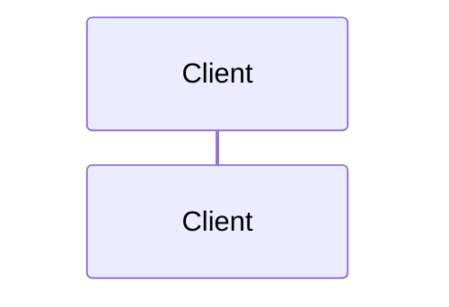

# STEP <id> – <Tên step>

> **Ngày:** YYYY-MM-DD · **Trạng thái:** ✅ Hoàn thành | 🟡 Dở dang · **Module:** `<module>`
> **Phụ thuộc:** STEP <...> · **Step tiếp theo:** STEP <next>

## 1. Mục tiêu
Bài toán thực tế mà step này giải quyết và kết quả nhìn thấy được (2–4 câu).

## 2. Đã làm những gì
- Theo thứ tự thực hiện, mỗi dòng 1 hành động cụ thể.

## 3. File đã tạo / thay đổi
| File | Thay đổi | Vai trò |
|---|---|---|
| [`backend/.../X.java`](../../backend/...) | Tạo mới | ... |

## 4. Luồng hoạt động
Sơ đồ mermaid (sequence/flowchart) hoặc ASCII: request/dữ liệu đi qua các thành phần thế nào.



**Giải thích:** bắt buộc ngay dưới **mỗi** sơ đồ, đánh số theo đúng thứ tự trên sơ đồ.

1. **<Tên bước trên sơ đồ>** ([`File.java`](../../backend/...)): chuyện gì xảy ra; vì sao làm vậy; nhánh lỗi thì trả về gì / điều gì xảy ra nếu bỏ bước này.
2. ...

## 5. Code then chốt
Chỉ những dòng mang tính quyết định, mỗi đoạn kèm **vì sao viết như vậy** và điều gì xảy ra nếu viết khác.

```java
// đoạn code ngắn, đúng với code hiện tại
```

## 6. Kiến thức trọng tâm
Mỗi khái niệm: định nghĩa ngắn → áp dụng ở đâu trong step này → hiểu lầm thường gặp.

### 6.1 <Khái niệm>

## 7. Trade-off & quyết định
| Phương án | Ưu | Nhược | Chọn? |
|---|---|---|---|

## 8. Vấn đề gặp phải & cách xử lý
- **Lỗi/triệu chứng:** thông báo thật → **Nguyên nhân** → **Cách sửa**
- Điểm lệch so với PLAN.md (nếu có) và PLAN đã được sửa thế nào.
- Phát hiện review 🟡 còn để lại (nếu có).

## 9. Kiểm chứng
```bash
# lệnh đã chạy thật
```
Kết quả thật (rút gọn). Số liệu đo được dạng bảng trước/sau, ghi điều kiện đo (số thread, kích thước dữ liệu, máy).

## 10. Câu hỏi phỏng vấn
1. **Hỏi:** ...
   **Trả lời gợi ý:** 2–4 câu, gắn với code của dự án.

## 11. Tự luyện thêm
- 1–3 bài tập nhỏ để tự làm (không có lời giải sẵn).

## 12. Bước tiếp theo
STEP <next> – <tên>: cần chuẩn bị/đọc gì trước.

<!--
Mẫu entry cho docs/problems.md:

## [STEP <id>] <Tên vấn đề>
- **Bối cảnh:** ...
- **Tái hiện:** test/lệnh nào, điều kiện gì
- **Triệu chứng:** số liệu (ví dụ: 100 thread, tồn kho 10, 37 đơn bán vượt)
- **Nguyên nhân gốc:** ...
- **Giải pháp:** ...
- **Kết quả sau khi sửa:** số liệu
- **Bài học:** 1–2 câu
-->
